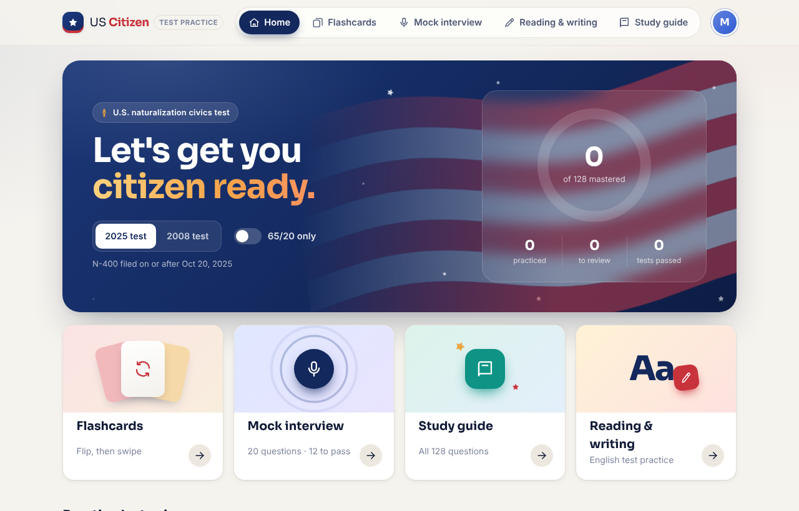
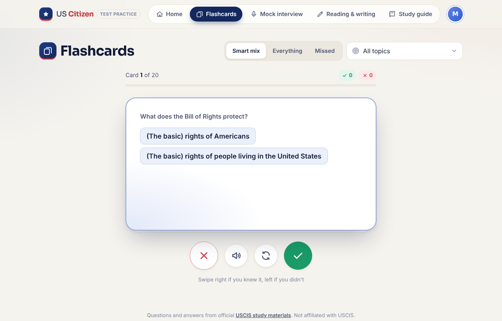
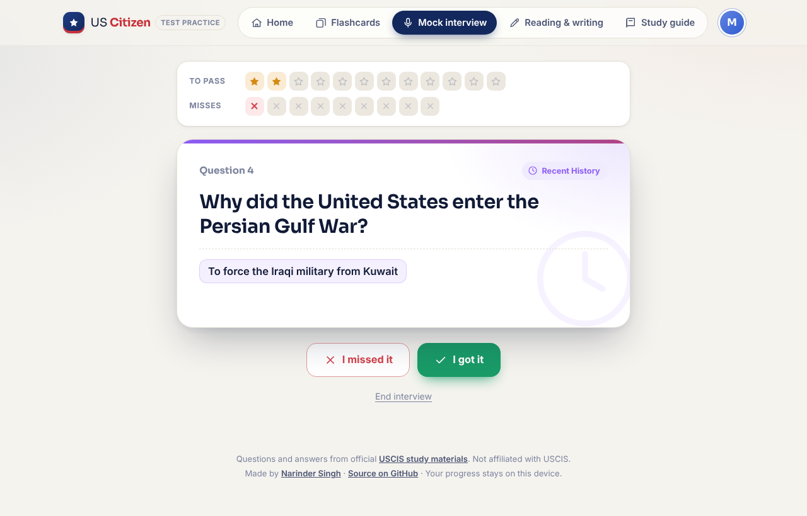
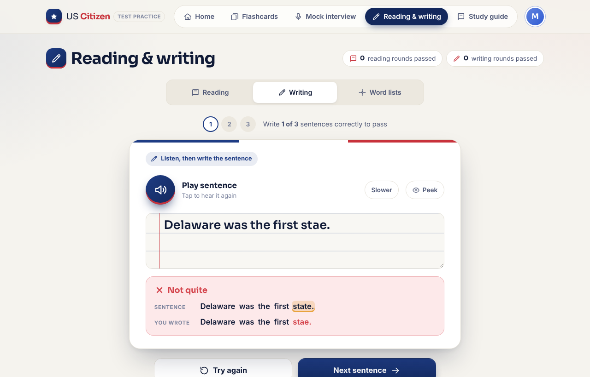

# US Citizen · Test Practice

A free, private study app for the U.S. naturalization test: every official USCIS civics question, flip-card flashcards, a mock interview that follows the real rules, and English reading and writing practice.

**Live app:** [uscitizen.nsingh.phd](https://uscitizen.nsingh.phd)



## Features

- **Both civics test versions.** The 2025 test (128 questions, for Form N-400 filed on or after Oct 20, 2025) and the 2008 test (100 questions), plus the 20-question 65/20 set.
- **Flashcards.** 3D flip cards you swipe right if you knew the answer and left if you didn't. Smart decks put missed and unseen questions first.
- **Mock interview.** Questions are asked one at a time and the test stops at the same points the officer does (2025: 12 correct or 9 missed; 2008 and 65/20: 6 correct or 5 missed). Listening mode reads each question aloud and hides the text.
- **Reading practice.** Rounds of up to 3 sentences, passing on the first one read correctly. Optional speech check highlights which words were heard.
- **Writing practice.** The app dictates a sentence, you type it, and you get word-by-word feedback.
- **Study guide.** Search, topic filters, and a "quiz me" mode that blurs answers until tapped.
- **About the civics test.** A plain-language page on the 2025 and 2008 rules, the 65/20 special consideration, exemptions, and links to every official USCIS source.
- **Your local answers.** Senators, representative, governor, and state capital are entered once and appear wherever those questions do.
- **Several learners on one device,** each with their own progress.
- Light and dark themes, phone-friendly layout, keyboard shortcuts, and reduced-motion support.

| Flashcards | Mock interview | Writing |
| --- | --- | --- |
|  |  |  |

## Privacy

There are no accounts, no analytics, and no server. Progress and personal answers are saved only in the browser's `localStorage`. The one exception is the optional "Check my reading" button, which uses the browser's built-in speech recognition; some browsers send that audio to their maker to transcribe it.

## Sources

All questions, answers, and vocabulary come from official USCIS materials (U.S. government works, public domain):

- [128 Civics Questions and Answers (2025 version)](https://www.uscis.gov/sites/default/files/document/questions-and-answers/2025-Civics-Test-128-Questions-and-Answers.pdf)
- [100 Civics Questions and Answers (2008 version)](https://www.uscis.gov/sites/default/files/document/questions-and-answers/100q.pdf)
- [Civics test updates](https://www.uscis.gov/citizenship/testupdates) for answers that change with elections (President, Vice President, Speaker, Chief Justice)
- [Reading vocabulary](https://www.uscis.gov/sites/default/files/document/questions-and-answers/reading_vocab.txt) and [writing vocabulary](https://www.uscis.gov/sites/default/files/document/questions-and-answers/writing_vocab.txt)

USCIS does not publish the sentences used in the reading and writing tests. The practice sentences in `english.js` are original and use only words from the official lists, which `scripts/check-sentences.js` verifies.

This project is not affiliated with or endorsed by USCIS or any government agency.

## Project structure

```
index.html        App shell
styles.css        All styling (light and dark themes)
app.js            App logic: routing, flashcards, mock interview, study guide, English practice
data.js           Civics questions and answers (2025 and 2008 versions)
english.js        Reading and writing vocabulary and practice sentences
fonts/            Sora (SIL Open Font License, see fonts/OFL.txt)
scripts/          Maintenance and publishing scripts
Makefile          `make merge-dev-to-main` shortcut
docs/             Screenshots and the social preview image
_headers          Cloudflare Pages response headers
```

Plain HTML, CSS, and JavaScript: no framework, no build step, no dependencies.

## Run locally

```bash
python3 -m http.server 8000
```

Then open http://localhost:8000/.

## Maintenance

- **After elections or appointments,** check the [USCIS test updates page](https://www.uscis.gov/citizenship/testupdates) and update the answers marked `"updates": true` in `data.js`, along with `testUpdatesLastUpdated`.
- **After editing practice sentences,** run:

  ```bash
  node scripts/check-sentences.js
  ```

## Deployment

Hosted on Cloudflare Pages, connected to this repo. No build command or output directory is needed.

- `main` is production: every push deploys to uscitizen.nsingh.phd.
- `dev` and work branches get Cloudflare preview URLs.
- Work happens on its own branch, then is published with:

  ```bash
  make merge-dev-to-main BRANCH=<work-branch>
  ```

  This merges the work branch into `dev`, merges `dev` into `main`, pushes both, and leaves them in sync. Without `BRANCH`, it publishes whatever is already on `dev`.

## License

Code is released under the [MIT License](LICENSE). The Sora font is licensed under the [SIL Open Font License](fonts/OFL.txt). USCIS content is in the public domain.

Made by [Narinder Singh](https://nsingh.phd).
